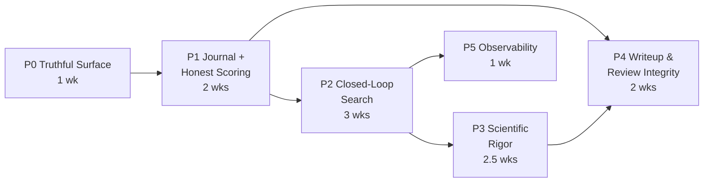

# Berb — Agentic Search & Scientific Rigor Implementation Plan

**Document ID:** BERB-IP-001
**Version:** 1.0
**Date:** 2026-07-19
**Author:** Engineering
**Status:** Draft for review
**Source analysis:** Comparative review of Berb against SakanaAI AI-Scientist-v2 (arXiv:2504.08066)

---

## Table of Contents

1. [Executive Summary](#1-executive-summary)
2. [Current Architecture Assessment](#2-current-architecture-assessment)
3. [Detailed Implementation Plan](#3-detailed-implementation-plan)
4. [Task Breakdown Structure (WBS)](#4-task-breakdown-structure-wbs)
5. [Risk & Mitigation Matrix](#5-risk--mitigation-matrix)
6. [Testing & Quality Assurance Strategy](#6-testing--quality-assurance-strategy)
7. [Deployment & Rollback Plan](#7-deployment--rollback-plan)
8. [Post-Implementation Validation Checklist](#8-post-implementation-validation-checklist)
9. [Appendices](#9-appendices)

---

## 1. Executive Summary

### 1.1 Problem Statement

Berb is a 23-stage autonomous research pipeline with strong *process* engineering — contract-validated stages, event sourcing, HITL gates, multi-source literature retrieval, citation verification, and sandbox isolation. Its scientific *search* capability, however, is materially weaker than its process suggests.

Comparative analysis against AI-Scientist-v2 identified a structural asymmetry:

> **Berb spends its compute on process; AI-Scientist-v2 spends its compute on search.**
> A rigorous pipeline wrapped around a single un-searched experiment produces a well-cited, well-verified paper about a mediocre result.

Three findings drive this plan:

1. **The advertised tree search does not exist.** `berb/research/tree_search.py` exports `ParallelizedTreeSearch`, which scores branches with `random.uniform(5, 9)`, has its LLM call commented out, and passes the literal string `"research topic"` during expansion. It has zero importers. The only sandbox-backed search — `CodeAgent._phase3_tree_search` — is disabled by default, sequential, depth-2, and scores candidates by stdout length rather than by the experiment's primary metric.

2. **Quality signals are detected but not acted upon.** The pipeline already detects insufficient seed counts, suspiciously fast runs, and figure defects — and responds to all three by writing a log line. None of these signals feed back into a control loop.

3. **There is no unified experiment journal.** Attempt state is scattered across per-stage run directories, `refinement_log.json`, `experiment_history.json`, and an EventStore that records only stage transitions. No single structure links an attempt's code, output, metric, figures, and parent — which is precisely the structure that makes search, best-candidate selection, and evidence assembly tractable.

### 1.2 Proposed Solution

Six phases over an estimated **10–12 engineering weeks**, delivering:

- **`ExperimentJournal`** — a persisted attempt tree that becomes the single source of truth for experimentation (Phase 1).
- **Metric-grounded, parallel, tree-diverse search** promoted from `CodeAgent` internals into the execution stage and enabled by default (Phase 2).
- **VLM figure verdicts as a control signal** (`is_buggy_plots`), excluding visually-broken attempts from candidate selection (Phase 2).
- **Staged research escalation** (baseline → tuning → creative → ablation) with LLM-judged completion (Phase 3).
- **Executed multi-seed evaluation** with mean ± standard-error aggregation (Phase 3).
- **Evidence-driven writeup reflection** and a negative-results track (Phase 4).
- **Per-run cost accounting and search visualization** (Phase 5).

Plus removal of stub and dead code that currently misrepresents system capability.

### 1.3 Key Architectural Constraint

> **`Stage` is an `IntEnum` whose successor is computed as `Stage(int(stage) + 1)` in `advance()`, with `23` hardcoded as the terminal value. Stage directories are named `stage-{int(stage):02d}`.**

Inserting a new stage mid-sequence renumbers every downstream stage, invalidates every existing run directory, breaks `--from-stage` resume, breaks checkpoint replay, and breaks a large fraction of the 128 KB `test_berb_executor.py` suite.

**Therefore: no new `Stage` enum members are introduced mid-sequence by this plan.** All new capability lands *inside* Stages 12 (`EXPERIMENT_RUN`) and 13 (`ITERATIVE_REFINE`), or is appended at ordinal ≥ 24 in a separately-scoped effort. This constraint is non-negotiable and is enforced by a CI guard (see §6.4).

### 1.4 Success Metrics

| Metric | Baseline | Target | Measurement |
|---|---|---|---|
| Experiment attempts per run | 1 + refine iterations | ≥ 12 (search-enabled profile) | `journal.json` node count |
| Attempts excluded on figure defects | 0 (not measured) | > 0 and logged | `is_buggy_plots` count |
| Runs reporting mean ± stderr over ≥ 3 seeds | 0% | ≥ 90% of successful runs | `seed_aggregate.json` presence |
| Best-candidate selection grounded in primary metric | No | Yes | Score function unit tests |
| Per-run cost attributable to phase | No | Yes | `cost_report.json` |
| Modules exported with zero importers | ≥ 3 | 0 | CI dead-export guard |
| Unit-test coverage | 55% floor (~57–58% actual) | 62% floor | `pytest --cov-fail-under` |

### 1.5 Investment & Risk Posture

- **Effort:** ~10–12 weeks, 1–2 engineers.
- **Cost impact:** Search multiplies LLM and sandbox usage. Mitigated by a **budget governor** (§3.2, E2-T6) and by shipping search **off by default** until Phase 2 exit criteria are met.
- **Highest risk:** cost/runtime explosion from parallel search (R-01) and contract-change breakage of resume (R-04). Both have explicit mitigations and rollback paths.
- **Backward compatibility:** All contract changes are additive-optional. Legacy run directories remain replayable throughout.

---

## 2. Current Architecture Assessment

### 2.1 Architectural Style

Berb implements a **contract-validated, plugin-registered, linear stage pipeline** with event-sourced state.

```
CLI (berb/cli.py)
  └─> Runner (berb/pipeline/runner.py)        — stage sequencing, gates, rollback
        └─> Executor (berb/pipeline/executor.py) — single-stage execution + contract validation
              └─> Registry (berb/pipeline/registry.py) — @register_stage decorator lookup
                    └─> Stage impls (berb/pipeline/stage_impls/_*.py)
                          └─> Subsystems (llm/, literature/, experiment/, review/, validation/, vision/)
```

**Strengths of the existing design that this plan preserves and builds on:**

| Property | Where | Why it matters here |
|---|---|---|
| Decorator-based stage registration | `registry.py:52` | New behaviour is added without editing `executor.py` |
| Declarative I/O contracts | `contracts.py:22` | Output existence and non-emptiness validated automatically (`executor.py:235-260`) |
| Signature introspection for optional kwargs | `executor.py:211-216` | Stage functions can gain parameters without breaking siblings |
| Frozen config dataclasses | `config.py` | Config is immutable, hashable, and safe to pass across process boundaries |
| Event-sourced pipeline state | `stages.py:431` (`EventStore`) | Replayable audit trail already exists; extend rather than replace |
| Port adapters bundle | `adapters.py` (`AdapterBundle`) | Dependency inversion boundary already in place for LLM/sandbox/store |

### 2.2 Module Boundaries and Dependency Direction

Current direction is broadly correct (`interfaces → pipeline → subsystems → config`), with two violations relevant to this work:

- **V-1 — Search logic embedded in a code-generation concern.** `CodeAgent._phase3_tree_search` (`code_agent.py:1217`) implements experiment search inside the *code generation* stage (Stage 10), even though search is fundamentally an *execution* concern (Stages 12–13). This couples "how do I write a program" to "which experiment is best," and prevents search from using post-execution signals such as figures or aggregated metrics.
- **V-2 — Orphan public API.** `berb/research/__init__.py` re-exports `ParallelizedTreeSearch` and `explore_research_space`, presenting a placeholder as a supported capability. Consumers reading the package surface reasonably conclude the feature exists.

Both are corrected in Phases 0 and 2.

### 2.3 Data Flow — Experimentation (current)

```
Stage 10 CODE_GENERATION
  CodeAgent.generate()
    Phase 1 blueprint → Phase 2 sequential gen → hard validation → exec-fix loop → Phase 5 review
    [Phase 3 tree search: DISABLED by default]
  → experiment/ (multi-file project)

Stage 12 EXPERIMENT_RUN                       (_execution.py:122)
  create_sandbox() → run_project()
  → runs/run-1.json      ← EXACTLY ONE RUN RECORD
  → runs/results.json    (structured, or auto-generated from stdout parsing)
  warnings emitted, not acted on:
    - elapsed < 5.0s   → "benchmark may be trivially easy"    (line 214)
    - seeds_run < 3    → "minimum 3 required"                 (line 288)
    - time budget      → time_budget_warning.json             (line 261)

Stage 13 ITERATIVE_REFINE                     (_execution.py:364)
  linear edit-run-eval loop → refinement_log.json, experiment_final/
```

**Assessment:** the flow is a *chain*, not a *search*. A single candidate is produced, run once, then linearly refined. There is no population, no branching, no candidate comparison, and no path by which a figure defect or a fast-completion signal changes what gets tried next.

### 2.4 Integration Points

| Integration | Module | Status | Relevance |
|---|---|---|---|
| Sandbox execution | `experiment/factory.py`, `docker_sandbox.py`, `ssh_sandbox.py`, `colab_sandbox.py` | Mature | Reused directly for parallel node evaluation |
| Async execution pool | `experiment/async_pool.py` | Present | Required for parallel search; must gain concurrency limits |
| Figure critique (VLM) | `agents/figure_agent/critic.py` | Mature, invoked at `orchestrator.py:408` | Currently paper-time only; to be promoted to experiment-time |
| Figure generation | `vision/figure_generator.py`, `figure_agent/codegen.py` | Mature | Reused for seed aggregation plots |
| Citation verification | `pipeline/citation_verification.py`, `validation/reference_integrity.py` | Mature | Feeds writeup reflection bundle |
| Manuscript self-check | `validation/manuscript_self_check.py`, `pipeline/paper_verifier.py` | Mature | Feeds writeup reflection bundle |
| Review ensembles | `review/{ensemble,jury_reviewer,council_mode,cross_model_reviewer}.py` | Mature | Gains few-shot calibration |
| LLM routing | `llm/{model_router,extended_router,model_cascade,nadirclaw_router}.py` | Mature | Must gain cost accounting hook |

### 2.5 Technical Debt Register

| ID | Debt | Location | Severity | Interest |
|---|---|---|---|---|
| TD-1 | Stub exported as public API | `research/tree_search.py`, `research/__init__.py:36-54` | **Critical** | Every reader mis-models system capability |
| TD-2 | Non-scientific scoring function | `code_agent.py:1324-1338` | **High** | Search, when enabled, optimizes the wrong objective |
| TD-3 | Detection without action (3 sites) | `_execution.py:214, 261, 280` | **High** | Known-bad conditions propagate into the paper |
| TD-4 | Fitness by LLM opinion, labelled as search | `experiment/evolutionary_search.py` | Medium | Designs ranked without execution evidence |
| TD-5 | Zero-importer modules | `pipeline/tdd_generation.py`, `pipeline/diff_revisions.py` | Medium | Maintenance cost, false capability signal |
| TD-6 | No per-run cost attribution | `llm/client.py` (no `total_cost`/`cost_usd`) | Medium | Cannot tune a 7-provider cascade without cost data |
| TD-7 | Three shapes of experiment results | `_execution.py:171-244` (structured / stdout-parsed / auto-generated) | Medium | Every downstream consumer branches three ways |
| TD-8 | Hardcoded terminal stage ordinal | `stages.py:260, 270` (`< 23`) | Medium | Blocks stage addition; already constrains this plan |
| TD-9 | Coverage floor below aspiration | `.github/workflows/ci.yml:48` (55% vs 70% intent) | Low | Documented and ratcheted, acceptable |

### 2.6 Scalability, Security, Maintainability

**Scalability.** Sandbox variety (local/docker/ssh/colab) is a genuine strength and makes horizontal execution feasible. The blocker is orchestration: nothing today submits N candidate evaluations concurrently with a bounded worker pool. `async_pool.py` exists but is not on the experiment path.

**Security.** Materially ahead of the comparison system. AI-Scientist-v2 executes LLM-authored code via `exec(compile(...))` in a subprocess on the host with full filesystem and network access; Berb has real container isolation, `compute_guard.py`, and `physics_guards.py`. **This plan must not regress that posture** — parallel search multiplies the number of LLM-authored programs executed per run, so isolation and resource caps become *more* load-bearing, not less. Concretely: every new evaluation path must go through `experiment/factory.create_sandbox`, never through direct subprocess invocation.

**Maintainability.** The dominant risk is **surface area**. ~50 subpackages, several with zero or one importer. Each stub that resembles a feature imposes a recurring cost on every future reader. Phase 0 addresses this directly and CI enforces it thereafter.

---

## 3. Detailed Implementation Plan

### 3.1 Phase Roadmap

| Phase | Name | Duration | Depends on | Exit criterion |
|---|---|---|---|---|
| **P0** | Truthful Surface & Instrumentation | 1 wk | — | No stub exported as API; cost report emitted per run |
| **P1** | Experiment Journal & Honest Scoring | 2 wks | P0 | Journal persisted; scoring metric-grounded; canonical result contract |
| **P2** | Closed-Loop Search | 3 wks | P1 | Parallel tree-diverse search default-on; `is_buggy_plots` gates selection |
| **P3** | Scientific Rigor | 2.5 wks | P2 | Staged escalation + executed multi-seed aggregation |
| **P4** | Writeup & Review Integrity | 2 wks | P1 (journal), P3 (aggregates) | Single evidence-driven reflection; negative-results track |
| **P5** | Observability | 1 wk | P2 | Search tree visualization shipped |



**Critical path:** P0 → P1 → P2 → P3 → P4. P5 runs parallel to P3/P4.

### 3.2 Milestones

| ID | Milestone | Phase | Gate |
|---|---|---|---|
| M1 | Public API reflects real capability | P0 | Dead-export CI guard green |
| M2 | `journal.json` emitted for every run | P1 | Schema-validated in E2E test |
| M3 | Search selects on primary metric | P1 | Property tests on score function |
| M4 | Parallel search default-on within budget | P2 | Cost regression < 3× single-shot baseline |
| M5 | Figure defects exclude candidates | P2 | Fixture with valid code + broken plots is rejected |
| M6 | Multi-seed aggregates in every paper | P3 | `seed_aggregate.json` in ≥ 90% of E2E runs |
| M7 | One evidence bundle drives revision | P4 | Reflection prompt assembled from ≥ 6 tool sources |
| M8 | Search tree renderable | P5 | HTML artifact opens, nodes navigable |

---

### 3.3 Work Breakdown — Fixes

---

#### **F1 — Remove the tree-search stub from the public API**

**Objective.** Eliminate a placeholder module that presents itself as a working parallelized tree search, so that the package surface truthfully reflects capability.

**Affected components.**
- `berb/research/tree_search.py` (delete)
- `berb/research/__init__.py:36-54` (remove re-exports)
- Any documentation referencing `ParallelizedTreeSearch`

**Evidence.**
- `tree_search.py:260-266` — LLM call commented out; `_generate_placeholder_branches` used instead.
- `tree_search.py:397-398` — `random.uniform(5, 9)` as novelty/feasibility score.
- `tree_search.py:477` — `_expand_node` passes literal `"research topic"`.
- Zero importers outside `research/__init__.py`.

**Design changes.** Deletion, not replacement. The genuine capability is delivered by E2 in `berb/experiment/search/`. `SearchConfig`'s scoring-weight concept is the one salvageable idea; it is carried forward into `SearchConfig` in E2 rather than preserved here.

**Implementation tasks.**
1. `git rm berb/research/tree_search.py`.
2. Strip `ParallelizedTreeSearch`, `BranchNode`, `SearchPath`, `SearchConfig`, `DecisionPoint`, `BranchStatus`, `explore_research_space` from `research/__init__.py` `__all__` and imports.
3. Grep for external references (`rg 'ParallelizedTreeSearch|explore_research_space'`) — expected: docs only.
4. Add `CHANGELOG` entry under **Removed** noting the API was never functional.

**Refactoring requirements.** None. Isolated deletion.

**Testing strategy.**
- Import smoke test: `import berb.research` succeeds.
- Negative test: `assert not hasattr(berb.research, "ParallelizedTreeSearch")`.
- Full unit suite must remain green (no importers expected).

**Acceptance criteria.**
- [ ] `berb/research/tree_search.py` absent.
- [ ] `rg "ParallelizedTreeSearch" --type py` returns no hits.
- [ ] `berb.research.__all__` contains only implemented symbols.
- [ ] CHANGELOG documents the removal and points to the replacement.

**Rollback.** `git revert` of a single, dependency-free commit.

---

#### **F2 — Ground candidate scoring in the primary metric**

**Objective.** Replace a scoring heuristic that rewards verbose stdout with one that rewards scientific quality.

**Affected components.** `berb/pipeline/code_agent.py:1324-1338` (`_score_node`), moving to `berb/experiment/search/scoring.py` under E2.

**Evidence.** Current implementation:
```python
if node.runs_ok:                             score += 1.0
if node.stdout and len(node.stdout) > 100:   score += 0.3
if node.metrics:                             score += 0.5
if metric_key in node.metrics:               score += 0.5
if node.stderr and "Error" in node.stderr:   score -= 0.2
```
A run producing 101 characters of stdout outranks one producing 99. The *value* of `metrics[metric_key]` never enters the computation — only its presence.

**Design changes.** New `ScoredCandidate` and a pure, injectable scoring function:

```python
@dataclass(frozen=True)
class ScoreBreakdown:
    total: float
    runs_ok: bool
    metric_value: float | None
    metric_normalized: float | None
    penalties: tuple[str, ...]
    reason: str          # human-readable, persisted to the journal


def score_node(
    node: JournalNode,
    metric_key: str,
    *,
    maximize: bool,
    baseline: float | None = None,
) -> ScoreBreakdown: ...
```

Rules, ordered:
1. **Hard gate.** `runs_ok is False` → total `0.0`. A crashed candidate is never preferred.
2. **Hard gate.** `is_buggy_plots is True` → total `0.0` (activated by E3).
3. **Primary term.** Normalized primary metric, direction-aware via `maximize`, min-max normalized across the candidate cohort so heterogeneous metric scales remain comparable.
4. **Secondary term.** Small bonus for metric completeness (all declared metrics present), capped so it can never outrank a genuine primary-metric improvement.
5. **Penalties.** NaN/Inf metric, timeout, `stderr` containing a traceback.
6. **Explainability.** Every score carries `reason`, persisted to the journal node.

Direction (`maximize`) is read from the experiment design rather than assumed — mirroring the `MetricValue.maximize` concept, and avoiding the classic loss-vs-accuracy inversion bug.

**Implementation tasks.**
1. Create `berb/experiment/search/scoring.py` with `ScoreBreakdown` and `score_node`.
2. Add `maximize: bool` to the metric declaration in `ExperimentConfig`; default inferred from `metric_key` (`loss`/`error`/`mse` → minimize) with an explicit override.
3. Implement cohort-relative normalization (`normalize_cohort(nodes) -> dict[node_id, float]`).
4. Replace `CodeAgent._score_node` with a delegating call; keep the method as a thin shim for one release, marked deprecated.
5. Persist `ScoreBreakdown` onto the journal node.

**Refactoring requirements.** Scoring becomes a pure function with no I/O and no LLM dependency — directly unit-testable and reusable by E2 and E4. This is the Single Responsibility fix for a method currently entangled with `CodeAgent` state.

**Testing strategy.**
- Property test: for a fixed cohort, a strictly better primary metric always yields a strictly higher score (both directions of `maximize`).
- Property test: any crashing node scores `0.0` regardless of other attributes.
- Regression test: stdout length has zero influence on ordering.
- Table-driven tests for NaN/Inf/missing-metric handling.

**Acceptance criteria.**
- [ ] `score_node` is pure (no I/O, no network) and covered ≥ 95%.
- [ ] Ordering is invariant to stdout length.
- [ ] `maximize=False` correctly prefers lower loss.
- [ ] Every scored node persists a human-readable `reason`.

**Rollback.** Config flag `experiment.search.scoring_version: "legacy" | "v2"`, defaulting to `v2`. Setting `legacy` restores the shim behaviour without redeploy.

---

#### **F3 — Convert seed-count validation from warning to mechanism**

**Objective.** Make statistical validity enforced rather than observed.

**Affected components.** `berb/pipeline/stage_impls/_execution.py:280-295`; new `berb/experiment/seed_eval.py` (E5).

**Evidence.** Current behaviour on detecting fewer than 3 seeds is `logger.warning(...)`. The run proceeds, and the single-seed result reaches the paper.

**Design changes.** Two-tier response:
- **Tier 1 (E5 dependency):** trigger an actual multi-seed re-run of the winning candidate.
- **Tier 2 (this fix):** if multi-seed evaluation is unavailable or fails, propagate a structured `StatisticalValidityWarning` into `analysis.md` and the paper's limitations section, so the deficiency is *disclosed* rather than silently dropped.

Tier 2 is the honesty backstop and must ship even if Tier 1 is degraded.

**Implementation tasks.**
1. Define `SeedValidity` dataclass: `{seeds_run, seeds_required, conditions_affected, remediation_attempted, disclosed}`.
2. Write `seed_validity.json` to the stage directory.
3. Have Stage 14 (`RESULT_ANALYSIS`) read it and emit an explicit limitations paragraph when `seeds_run < seeds_required`.
4. Have Stage 20 (`QUALITY_GATE`) downgrade the quality score when an undisclosed validity gap exists.

**Refactoring requirements.** None structural — `_execute_result_analysis` gains one input read.

**Testing strategy.**
- Unit: single-seed fixture produces `seed_validity.json` with `disclosed=True`.
- Integration: single-seed run yields a paper containing an explicit statistical-limitation statement.
- Integration: 3-seed run produces no limitation statement.

**Acceptance criteria.**
- [ ] No run reports results from `< 3` seeds without a disclosure in the manuscript.
- [ ] `seed_validity.json` present whenever Stage 12 completes.
- [ ] Quality gate reflects undisclosed validity gaps.

**Rollback.** `experiment.seed_policy: "warn" | "disclose" | "enforce"`, default `disclose`. Revert to `warn` restores current behaviour.

---

#### **F4 — Act on the triviality signal**

**Objective.** Feed the existing "benchmark may be trivially easy" detection into the refinement loop instead of discarding it.

**Affected components.** `_execution.py:214-220` (detection), `_execution.py:364+` (`_execute_iterative_refine`), refinement prompt templates.

**Evidence.** The condition `elapsed_sec < 5.0` is detected and logged. The comparison system uses the analogous signal as prompt feedback that explicitly instructs the agent to scale up epochs, model size, or dataset size, then re-runs — turning a passive observation into a control action.

**Design changes.** Introduce `ExecutionFeedback`, a typed carrier for signals produced at execution time and consumed at refinement time:

```python
@dataclass(frozen=True)
class ExecutionFeedback:
    kind: Literal["trivial_runtime", "timeout", "budget_underuse", "no_metrics"]
    severity: Literal["info", "warn", "block"]
    message: str            # rendered verbatim into the refinement prompt
    suggested_action: str
```

Written to `execution_feedback.json` in Stage 12; read by Stage 13 and injected into the refinement prompt. Threshold moves from the literal `5.0` to `experiment.trivial_runtime_ratio` (default `0.05` of `time_budget_sec`), removing a magic number and making the check budget-relative.

**Implementation tasks.**
1. Define `ExecutionFeedback` in `berb/pipeline/contracts.py` (shared vocabulary, no new dependency direction).
2. Emit feedback records at all three existing detection sites (triviality, timeout, budget underuse).
3. Add `execution_feedback.json` to Stage 12 contract `output_files` **as optional** (see R-04 mitigation — introduce an `optional_output_files` field rather than mutating `output_files`).
4. Read and render feedback in `_execute_iterative_refine`'s prompt assembly.
5. Add a refinement-prompt section: *"Execution feedback from the previous run (address these before optimizing further)."*

**Refactoring requirements.** `StageContract` gains `optional_output_files: tuple[str, ...] = ()`. `executor.py:235-260` validation must skip optional outputs. This is an additive, backward-compatible change to a frozen dataclass with a default.

**Testing strategy.**
- Unit: a 0.5 s run against a 300 s budget produces a `trivial_runtime` feedback record.
- Unit: contract validation passes when an optional output is absent.
- Integration: the refinement prompt contains the feedback text.
- Regression: all 23 existing contracts validate unchanged.

**Acceptance criteria.**
- [ ] Triviality detection produces an artifact, not only a log line.
- [ ] Refinement prompt demonstrably includes execution feedback.
- [ ] Threshold is configuration-driven and budget-relative.
- [ ] Optional outputs do not fail contract validation.

**Rollback.** Feedback injection behind `experiment.feedback_injection: bool = True`. Disabling restores log-only behaviour; the artifact continues to be written (harmless).

---

#### **F5 — Retire zero-importer modules**

**Objective.** Reduce surface area and eliminate false capability signals.

**Affected components.** `berb/pipeline/tdd_generation.py`, `berb/pipeline/diff_revisions.py` (0 importers each).

**Design changes.** For each module, one of three dispositions, decided by the owning engineer and recorded in the PR:
- **Wire it** — if the capability is wanted, integrate and test it.
- **Delete it** — if superseded.
- **Quarantine it** — move to `berb/experimental/` with a module-level docstring stating it is unwired, and exclude from `__all__`.

Default disposition is **delete**; quarantine requires written justification.

**Implementation tasks.**
1. Import-graph audit: `rg -l "from berb.pipeline.<mod> import|pipeline\.<mod>"`.
2. Record disposition per module in the PR description.
3. Execute disposition; update `CHANGELOG`.
4. Add the CI dead-export guard (see §6.4) to prevent recurrence.

**Testing strategy.** Full unit suite green post-removal; coverage percentage must not *drop* (removing untested code should raise it).

**Acceptance criteria.**
- [ ] Zero modules in `berb/pipeline/` with no importers and no test.
- [ ] CI guard fails a PR that introduces one.
- [ ] Coverage floor raised if removal increases measured coverage.

**Rollback.** `git revert`; modules are self-contained.

---

#### **F6 — Rename and re-document evolutionary search**

**Objective.** Stop describing LLM-opinion ranking of unexecuted designs as "search."

**Affected components.** `berb/experiment/evolutionary_search.py`, `berb/experiment/__init__.py:26`, `berb/pipeline/optimization_integration/experiment_integration.py:100-202`.

**Evidence.** `search()` evolves `ExperimentDesign` objects and scores them with an LLM fitness function, defaulting to `5.0` on exception (`evolutionary_search.py:298,308`). No sandbox execution occurs. Fitness is an opinion, not a measurement.

**Design changes.** Two options, decided at Phase 0 planning:
- **Option A (recommended, lower cost):** rename to `DesignProposalEvolver`; module docstring states explicitly that fitness is LLM-judged and not execution-grounded; position it as a *design-space generator* feeding E2's search with diverse seeds.
- **Option B (higher value, higher cost):** make fitness execution-grounded by evaluating each design through E2's search. Defer to a post-P3 follow-up.

Plan assumes **Option A**, with Option B recorded as a backlog item.

**Implementation tasks.**
1. Rename class and module; keep a deprecation alias for one release.
2. Rewrite module docstring: state the fitness source, the `5.0` fallback, and the non-execution semantics.
3. Replace the silent `5.0` fallback with an explicit `fitness_source: Literal["llm", "default_fallback"]` field so downstream consumers can distinguish a real judgement from a failure default.
4. Wire the evolver's output as candidate seeds for E2 (`initial_candidates` parameter).

**Testing strategy.**
- Unit: LLM exception yields `fitness_source == "default_fallback"`.
- Unit: deprecation alias emits `DeprecationWarning` and resolves.

**Acceptance criteria.**
- [ ] Name and docstring reflect LLM-judged, non-executed semantics.
- [ ] Fallback fitness is distinguishable from genuine fitness.
- [ ] Deprecation alias present for one release cycle.

**Rollback.** Alias retention makes this non-breaking; revert is a docstring-and-name change.

---

### 3.4 Work Breakdown — Enhancements

---

#### **E1 — `ExperimentJournal`: unified attempt tree** ⭐ *Foundational*

**Objective.** Provide a single, persisted, replayable structure recording every experiment attempt with its full provenance — the substrate on which E2, E3, E4, E5, E7, and E11 all depend.

**Affected components.**
- **New:** `berb/experiment/journal.py`
- `berb/pipeline/stage_impls/_execution.py` (Stages 12, 13 write to it)
- `berb/pipeline/stage_impls/_analysis.py` (Stage 14 reads it)
- `berb/pipeline/stage_impls/_paper_writing.py` (Stages 16–17 read it)
- `berb/pipeline/contracts.py` (optional output `journal.json`)

**Design changes.**

```python
@dataclass
class JournalNode:
    # Identity & topology
    node_id: str
    parent_id: str | None
    depth: int
    phase: str                         # "baseline" | "tuning" | "creative" | "ablation"
    origin: Literal["draft", "debug", "improve", "ablation", "hyperparam", "seed"]

    # Content
    plan: str
    files: dict[str, str]
    plot_code: str | None

    # Execution evidence
    returncode: int | None
    stdout: str
    stderr: str
    elapsed_sec: float | None
    timed_out: bool
    metrics: dict[str, float]

    # Evaluation
    analysis: str | None               # LLM reading of stdout + traceback
    is_buggy: bool | None
    is_buggy_plots: bool | None        # VLM verdict (E3)
    plot_paths: tuple[Path, ...]
    plot_analyses: tuple[dict, ...]
    vlm_feedback_summary: str | None
    score: ScoreBreakdown | None       # F2

    # Bookkeeping
    ablation_name: str | None
    hyperparam_name: str | None
    seed: int | None
    cost_usd: float                    # E10
    created_at: datetime


class ExperimentJournal:
    def append(self, node: JournalNode) -> None: ...
    def children_of(self, node_id: str) -> list[JournalNode]: ...
    def leaves(self) -> list[JournalNode]: ...
    def roots(self) -> list[JournalNode]: ...
    def good_nodes(self) -> list[JournalNode]:
        """Nodes that both ran cleanly AND produced valid figures."""
        return [n for n in self._nodes
                if n.is_buggy is False and n.is_buggy_plots is not True]
    def best_node(self, metric_key: str, *, maximize: bool) -> JournalNode | None: ...
    def to_json(self) -> str: ...
    @classmethod
    def from_json(cls, text: str) -> ExperimentJournal: ...
```

**Design decisions, with rationale:**

1. **Parent by ID, not by object reference.** Object graphs with bidirectional parent/child links require custom `__deepcopy__`, `__getstate__`, and `__hash__` handling to survive pickling across process boundaries — a known source of fragility in the reference implementation. ID-based topology serializes to plain JSON with no special handling and crosses process boundaries safely.

2. **`good_nodes` requires *both* clean execution and valid figures.** This is the single most valuable idea imported from the comparison system. A program that exits `0` while plotting noise is not a good scientific result, and today nothing in Berb prevents it from becoming the paper's headline.

3. **`is_buggy_plots is not True`, not `is False`.** Three-valued logic: `None` means "not yet evaluated" and must not exclude a node before E3 is enabled. This keeps E1 shippable independently of E3.

4. **JSON, not pickle.** Human-inspectable, diffable, versionable, and safe to load from an untrusted run directory. Includes a `schema_version` field for forward migration.

5. **Journal is append-only.** Consistent with the existing `EventStore` philosophy (`stages.py:463`). Mutation of an appended node is disallowed; evaluation results arrive via `journal.record_evaluation(node_id, ...)` which appends a revision rather than editing in place.

**Implementation tasks.**
1. Implement `JournalNode`, `ExperimentJournal`, JSON round-trip with `schema_version`.
2. JSON-Schema document at `docs/schemas/experiment_journal.schema.json`; validate in tests.
3. Instrument Stage 12 to append a node per execution.
4. Instrument Stage 13 to append a node per refinement iteration with correct `parent_id`.
5. Add `journal.json` to Stages 12 and 13 contracts as **optional** output.
6. Provide `ExperimentJournal.from_legacy_run_dir()` to synthesize a journal from `run-*.json` + `refinement_log.json`, so pre-existing runs remain analyzable.
7. Add `berb journal show <run_dir>` CLI subcommand for inspection.

**Refactoring requirements.**
- Stages 14, 16, 17 gain journal-aware code paths, **retaining** their existing `runs/*.json` readers as fallback. No consumer is forced to migrate in this phase.
- `_collect_raw_experiment_metrics` (`_paper_writing.py`) is the natural first consumer: prefer journal, fall back to legacy.

**Testing strategy.**
- Round-trip property test: `from_json(to_json(j)) == j` for randomly generated journals (Hypothesis).
- Topology tests: `leaves`, `roots`, `children_of` on hand-built trees including multi-root forests.
- Three-valued logic test: `is_buggy_plots=None` nodes are *included* in `good_nodes`.
- Legacy migration test against a checked-in fixture run directory.
- Schema validation test against the published JSON Schema.
- Concurrency test: appends from a multi-worker pool preserve every node.

**Acceptance criteria.**
- [ ] `journal.json` written for every Stage 12/13 execution.
- [ ] Round-trip lossless; schema-validated.
- [ ] `good_nodes` semantics correct under all three values of `is_buggy_plots`.
- [ ] Legacy run directories produce a valid synthesized journal.
- [ ] Coverage ≥ 90% on `journal.py`.
- [ ] Zero changes required in downstream stages for them to keep working.

**Rollback.** Journal writing is additive and its contract entry is optional. Disabling `experiment.journal_enabled` stops emission; all legacy paths remain intact. No data loss and no consumer breakage.

---

#### **E2 — Promote search into the execution stage** ⭐ *Core value*

**Objective.** Replace single-shot experiment execution with a parallel, tree-diverse, metric-grounded search over candidate implementations, enabled by default within a governed budget.

**Affected components.**
- **New:** `berb/experiment/search/{__init__,policy,scoring,runner}.py`
- `berb/pipeline/stage_impls/_execution.py` (Stage 12 becomes search-driven)
- `berb/pipeline/code_agent.py` (`_phase3_tree_search` removed; `CodeAgent` returns candidates)
- `berb/experiment/async_pool.py` (bounded concurrency)
- `berb/config.py` (`SearchConfig`)

**Design changes.**

*Boundary correction (fixes V-1).* `CodeAgent`'s responsibility narrows to **producing candidate implementations**; `SearchRunner`'s responsibility is **evaluating and selecting among them**. Generation and selection become separately testable.

```python
@dataclass(frozen=True)
class SearchConfig:
    enabled: bool = False              # flipped to True at M4
    num_workers: int = 3
    num_roots: int = 3                 # independent solution trees
    max_nodes: int = 12                # hard cap on evaluations
    max_depth: int = 3
    debug_probability: float = 0.5
    max_debug_depth: int = 3
    eval_timeout_sec: int = 300
    budget_usd: float = 5.0            # hard stop
    budget_wallclock_sec: int = 3600   # hard stop


class SearchPolicy(Protocol):
    def select(self, journal: ExperimentJournal, n: int) -> list[JournalNode | None]:
        """Return n nodes to expand. `None` means 'create a new root'."""
```

*Default policy — `BestFirstDiversePolicy`*, three rules in order:

1. **Bootstrap.** While `len(journal.roots()) < num_roots`, emit `None` — grow independent trees before deepening any one.
2. **Repair.** With probability `debug_probability`, select a random buggy leaf whose `debug_depth <= max_debug_depth`.
3. **Exploit with diversity.** Otherwise select the best node — **subject to a tree-diversity constraint**: no two workers in the same batch expand nodes sharing a root, unless every root is already claimed.

Rule 3's diversity constraint is the substantive contribution. Without it, N workers converge on the same frontier and parallelism buys throughput but not exploration. This is why the reference implementation tracks `processed_trees`, and it is the difference between "N× faster hill climbing" and "actual search."

*Budget governor.* Before each batch, `SearchRunner` checks accumulated cost (E10) and wall-clock. On breach it stops expansion, evaluates outstanding nodes, and returns the best found so far with `termination_reason` recorded in the journal. **Search never terminates without a result.**

*Security invariant.* Every candidate evaluation is dispatched through `experiment.factory.create_sandbox`. Direct subprocess execution is prohibited and enforced by a CI grep guard (§6.4). Parallel search multiplies the number of LLM-authored programs executed per run; isolation must scale with it.

**Implementation tasks.**
1. `SearchConfig` frozen dataclass + `config.py` parsing with safe defaults.
2. `SearchPolicy` protocol + `BestFirstDiversePolicy`; policy is injectable (Dependency Inversion — enables a `GreedyPolicy` for tests and a future `MCTSPolicy`).
3. `SearchRunner.run(journal, generator, sandbox_factory) -> JournalNode`.
4. Bounded-concurrency evaluation via `async_pool` with `num_workers` semaphore; per-node sandbox isolation.
5. Budget governor with wall-clock and USD hard stops.
6. Narrow `CodeAgent.generate()` to return `list[Candidate]`; delete `_phase3_tree_search`.
7. Rewire Stage 12: when `search.enabled`, run `SearchRunner`; otherwise preserve the exact current single-run path.
8. Persist `search_summary.json` (nodes explored, cost, wall-clock, termination reason, best node ID).

**Refactoring requirements.**
- **Delete** `CodeAgent._phase3_tree_search` and `_evaluate_node`. Their logic is superseded; retaining both would violate DRY and guarantee divergence.
- Migrate `CodeAgentConfig.tree_search_*` fields to `SearchConfig`, retaining the old names as deprecated aliases that emit a warning and forward.
- `async_pool` gains an explicit concurrency limit — currently unbounded, which is unsafe once N sandboxes run concurrently.

**Testing strategy.**
- **Unit (policy, no I/O):** bootstrap emits `None` until `num_roots` reached; diversity constraint never returns two same-root nodes while a free root exists; debug selection respects `max_debug_depth`.
- **Unit (governor):** breaching either budget stops expansion and still returns the best node with the correct `termination_reason`.
- **Integration (fake sandbox):** deterministic sandbox stub returning scripted metrics; assert the search converges on the known-best candidate.
- **Integration (real sandbox, `@pytest.mark.slow`):** 3 candidates, 2 deliberately crashing; assert the working candidate is selected.
- **Concurrency:** `num_workers=4` produces exactly `max_nodes` journal entries with no interleaving corruption.
- **Cost regression:** search-enabled run stays within 3× the single-shot baseline (asserted in CI against a recorded fixture).

**Acceptance criteria.**
- [ ] Search runs `num_workers` evaluations concurrently in isolated sandboxes.
- [ ] Tree-diversity constraint verified by unit test.
- [ ] Budget breach always yields a usable best node.
- [ ] `search.enabled=False` reproduces current single-run behaviour byte-for-byte on a fixture run.
- [ ] Every evaluation routed through `create_sandbox` (CI guard green).
- [ ] `search_summary.json` emitted with all fields populated.
- [ ] Cost regression test within 3× baseline.

**Rollback.** `experiment.search.enabled: false` is the master switch and the default until M4. The legacy single-run path is retained in full, not merely reachable — meaning rollback is a config change with zero code motion. Deprecated `tree_search_*` aliases keep existing configs valid.

---

#### **E3 — `is_buggy_plots`: VLM figure verdict as a control signal** ⭐ *Highest leverage per line*

**Objective.** Prevent experiments that execute cleanly but produce meaningless figures from being selected as the best result.

**Affected components.**
- `berb/agents/figure_agent/critic.py` (existing, invoked at `orchestrator.py:408`)
- **New:** `berb/experiment/plot_verdict.py`
- `berb/experiment/journal.py` (field already reserved in E1)
- `berb/experiment/search/scoring.py` (hard gate, reserved in F2)

**Rationale.** Berb already owns a competent VLM figure critic — it simply runs at the wrong time. Today it evaluates figures *after* the science is settled, when its findings can only prompt cosmetic revision. Moving the same component upstream converts it from a proofreader into a referee: its verdict determines which experiment the paper is *about*.

This is the cheapest large win in the plan. The component exists; the change is positional.

**Design changes.**

```python
@dataclass(frozen=True)
class PlotVerdict:
    valid_plots_received: bool
    per_plot: tuple[PlotAnalysis, ...]
    summary: str
    datasets_evidenced: tuple[str, ...]
    confidence: float


def verify_plots(
    plot_paths: Sequence[Path],
    *,
    research_context: str,
    critic: FigureCritic,
    max_plots: int = 10,
) -> PlotVerdict: ...
```

**Guardrails, each addressing a specific failure mode:**

1. **Plot-count cap.** More than `max_plots` figures triggers LLM-assisted selection of the most informative subset, with a deterministic first-`N` fallback. Prevents unbounded VLM cost on runs that emit one figure per epoch.
2. **Anti-hallucination instruction.** The prompt states explicitly that the model must report "no plots received" when given none and must never invent an analysis. Ordering must correspond to input order.
3. **Fail-open on infrastructure error.** If the VLM is unavailable, `is_buggy_plots` stays `None` — never `True`. An outage must not silently reject every candidate. This is why E1 uses three-valued logic.
4. **Confidence floor.** Verdicts below `plot_verdict_min_confidence` (default `0.6`) are recorded but do not gate selection. A low-confidence rejection is advisory.

**Implementation tasks.**
1. `verify_plots` wrapping `FigureCritic` with the four guardrails.
2. Collect `plot_paths` from each candidate's sandbox working directory after evaluation.
3. Call `verify_plots`; write `is_buggy_plots`, `plot_analyses`, `vlm_feedback_summary` to the journal node.
4. Activate the hard gate in `score_node` (reserved in F2).
5. Inject `vlm_feedback_summary` into the debug/improve prompt for the next expansion of that node — closing the loop.
6. Config: `experiment.plot_verdict_enabled` (default `True`), `plot_verdict_min_confidence`, `max_plots_per_verdict`.

**Refactoring requirements.** `FigureCritic` must be callable outside the figure-agent orchestrator. If it currently depends on orchestrator state, extract a pure `critique(images, context) -> Analysis` core and have both callers use it (DRY; avoids a second critic implementation).

**Testing strategy.**
- **Fixture-driven, no live VLM:** checked-in PNG pairs (valid training curves / blank-and-noise) with recorded critic responses; assert correct verdicts.
- **Fail-open:** VLM raising an exception leaves `is_buggy_plots is None` and does not exclude the node.
- **Gate:** a node with `runs_ok=True, is_buggy_plots=True` scores `0.0`.
- **Confidence floor:** a `confidence=0.4` rejection does not gate.
- **Cap:** 25 plots triggers selection down to ≤ 10.
- **Loop closure:** VLM summary text appears in the subsequent improve prompt.

**Acceptance criteria.**
- [ ] Clean-exit-but-broken-figures candidate is excluded from `good_nodes`.
- [ ] VLM outage never rejects candidates.
- [ ] Low-confidence verdicts are advisory only.
- [ ] Plot count bounded per verdict.
- [ ] Feedback demonstrably reaches the next generation prompt.

**Rollback.** `experiment.plot_verdict_enabled: false` reverts to execution-only judgement. Because the field is three-valued, disabling it is indistinguishable from "not yet evaluated" and no downstream logic breaks.

---

#### **E4 — Staged research escalation**

**Objective.** Replace one undifferentiated experiment phase with a progression that establishes a baseline, tunes it, explores creative improvement, then ablates — each phase judged complete by evidence rather than by iteration count alone.

**Affected components.** **New:** `berb/experiment/phases.py`; `_execution.py` (Stages 12–13); `berb/prompts.py` (phase-specific templates).

**Constraint compliance.** Phases are implemented **inside** Stages 12/13 as an internal loop. **No `Stage` enum members are added.** Each phase owns its own `ExperimentJournal`, all persisted under `stage-12/journals/{phase}.json`.

**Design changes.**

| Phase | Goal | Inherits | Completion criterion |
|---|---|---|---|
| `baseline` | Simple working implementation | — | ≥ 1 node in `good_nodes` |
| `tuning` | Hyperparameters only; **architecture frozen** | best baseline | LLM-judged vs figure evidence **AND** best ≠ inherited node |
| `creative` | Novel improvements | best tuning | LLM-judged **AND** best ≠ inherited **AND** runtime not trivial |
| `ablation` | Systematic component analysis | best creative | All planned ablations attempted or `max_nodes` reached |

**Three non-obvious rules, each preventing a specific failure:**

1. **Baseline failure aborts the run.** If `baseline` exhausts its node budget without a single good node, the pipeline stops and reports honestly. It does **not** proceed to write a paper about an implementation that never worked. This is the most important rule in E4.

2. **"Best ≠ inherited" blocks phantom progress.** A phase whose winner is still the node it inherited has demonstrated nothing. Without this check, an LLM completion judge will happily approve a phase that changed nothing.

3. **Architecture freeze in `tuning`.** Prompt-enforced. Without it, "tuning" silently becomes "redesign," and the ablation phase later has no stable baseline to ablate against.

*Completion judgement.* A structured LLM call returning `{is_complete: bool, reasoning: str, missing_criteria: list[str]}`, given phase goals plus VLM figure feedback. `missing_criteria` is fed into the next expansion prompt — the judge's objection becomes the next instruction.

**Implementation tasks.**
1. `ResearchPhase` enum and `PhaseSpec` dataclass (goals, max nodes, completion rule).
2. `PhaseRunner` orchestrating phase sequence, journal-per-phase, and best-node inheritance.
3. Structured completion evaluator with a strict JSON contract and a deterministic fallback (max-nodes) on parse failure.
4. Phase-specific prompt templates in `prompts.default.yaml`.
5. Ablation idea generator with cross-worker deduplication (`completed_ablations` set) so parallel workers never run the same ablation twice.
6. Hyperparameter idea generator with the same dedup discipline.
7. Baseline-failure abort path with a clear, actionable operator message.

**Refactoring requirements.** Stage 12's body becomes a thin driver over `PhaseRunner`. Function length must stay under the 50-line project guideline — extract per-phase helpers.

**Testing strategy.**
- Unit: phase sequencing and inheritance with a stubbed search runner.
- Unit: baseline failure aborts; no downstream stage is invoked.
- Unit: "best == inherited" prevents completion.
- Unit: ablation dedup under 4 concurrent workers.
- Unit: completion-evaluator JSON parse failure falls back to max-nodes.
- Integration (`slow`): full 4-phase run on a trivial reference task.

**Acceptance criteria.**
- [ ] Four phases execute in order with correct inheritance.
- [ ] Baseline failure aborts with a clear message and no paper.
- [ ] Phantom-progress rule verified by test.
- [ ] No duplicate ablation names across parallel workers.
- [ ] Per-phase journals persisted.
- [ ] No `Stage` enum change (CI guard green).

**Rollback.** `experiment.phases_enabled: false` collapses to a single `baseline` phase, which is behaviourally equivalent to E2-only operation.

---

#### **E5 — Executed multi-seed evaluation and aggregation**

**Objective.** Turn seed-count validation from a warning into a measurement, and report mean ± standard error.

**Affected components.** **New:** `berb/experiment/seed_eval.py`; `_execution.py`; `vision/figure_generator.py`; `_analysis.py`.

**Design changes.** At each phase boundary (E4) or at end of search (E2 without E4):

1. Re-run the winning candidate's code with `num_seeds` distinct seeds (default `3`).
2. Append each as a journal node with `origin="seed"` and the `seed` field set.
3. Aggregate into `seed_aggregate.json`: per-metric `mean`, `std`, `stderr`, `n`, `values`.
4. Generate aggregate figures with error bars.
5. Feed the aggregate — not the single best seed — into Stage 14 analysis and the manuscript.

*Seed injection.* Seeds are supplied via sandbox environment variable `BERB_SEED`, and the code contract (E6) requires generated programs to read and apply it to all RNG sources (`random`, `numpy`, framework RNG). This avoids brittle source rewriting.

*Aggregation honesty.* The figure-generation prompt states: **"Plot only values present in the results file. Do not simulate, interpolate, or invent data points."** Berb's `hallucination_detector` provides a second, independent check on aggregate figures.

*Partial-failure policy.* If `k < n` seeds succeed:
- `k >= 2` → aggregate over `k`, record `n_requested` vs `n_succeeded`, and disclose in limitations.
- `k < 2` → no aggregate; F3's disclosure path activates.

Never silently report over fewer seeds than requested.

**Implementation tasks.**
1. `run_seeds(node, n, sandbox_factory) -> list[JournalNode]` with bounded concurrency.
2. `aggregate_seeds(nodes) -> SeedAggregate` (mean/std/stderr/n, NaN-safe).
3. Aggregate figure generation with error bars.
4. `seed_aggregate.json` as optional Stage 12 output.
5. Stage 14 prefers the aggregate over any single run.
6. Wire F3's `SeedValidity` disclosure to `n_succeeded`.

**Refactoring requirements.** Metric parsing (`_parse_metrics_from_stdout`, `_helpers.py`) must be reused, not reimplemented, for seed runs (DRY).

**Testing strategy.**
- Unit: statistical correctness of mean/std/stderr against `numpy` reference values.
- Unit: NaN-safe aggregation.
- Unit: partial failure with `k=2` aggregates and discloses; `k=1` refuses and discloses.
- Integration: 3 seeds produce 3 journal nodes and a valid aggregate.
- Integration: aggregate figure contains error bars (assert on plotting call arguments).

**Acceptance criteria.**
- [ ] Winning candidate re-run across `num_seeds` seeds.
- [ ] `seed_aggregate.json` with correct statistics.
- [ ] Aggregate figures carry error bars.
- [ ] Stage 14 consumes the aggregate, not a single run.
- [ ] Partial failure disclosed, never hidden.

**Rollback.** `experiment.num_seeds: 1` disables re-running; F3's disclosure path then covers the validity gap.

---

#### **E6 — Canonical experiment result contract**

**Objective.** Collapse three result shapes into one, removing three-way branching from every downstream consumer.

**Affected components.** `berb/domains/experiment_schema.py`, `_execution.py:171-244`, `_code_generation.py` prompts, `_analysis.py`, `_paper_writing.py`.

**Evidence (TD-7).** Stage 12 currently handles: structured `results.json`; metrics parsed from stdout; and an auto-generated `results.json` synthesized from parsed stdout. Every consumer must handle all three.

**Design changes.** One prompt-enforced schema, mirroring the approach that makes cross-node comparison free in the reference system — the contract is enforced at generation time by prompt, and validated at ingest time by schema:

```json
{
  "schema_version": "1.0",
  "seed": 42,
  "conditions": {
    "<condition_name>": {
      "metrics":  {"<name>": [<per-epoch values>]},
      "losses":   {"train": [...], "val": [...]},
      "final":    {"<name>": <scalar>},
      "n_seeds_run": 1
    }
  },
  "figures": ["<relative paths>"],
  "meta": {"elapsed_sec": 0.0, "device": "cuda"}
}
```

Generated code is instructed to write exactly this to `results.json`. Stdout parsing is **retained as a fallback only**, and any fallback use is recorded as `result_source: "stdout_fallback"` on the journal node so degradation is visible rather than silent.

**Implementation tasks.**
1. Publish `docs/schemas/experiment_results.schema.json`.
2. Add contract text to the code-generation prompt (structure + `BERB_SEED` handling from E5).
3. Implement `load_results(path) -> ExperimentResults` with schema validation and typed errors.
4. Implement `coerce_legacy(stdout_metrics) -> ExperimentResults` for the fallback path.
5. Record `result_source` on every journal node.
6. Migrate consumers to `ExperimentResults`; delete the three-way branching.

**Refactoring requirements.** This is the DRY payoff of the phase: one loader, one type, one code path. Every `if structured_results is None` branch in `_execution.py` is removed.

**Testing strategy.**
- Schema-validation tests: valid, invalid, and partially-valid documents.
- Legacy coercion test producing an equivalent typed object.
- Consumer tests asserting identical behaviour across native and coerced inputs.
- Prompt test: generated code emits schema-valid output (fixture-based, no live LLM).

**Acceptance criteria.**
- [ ] Published, versioned schema.
- [ ] Single loader; no three-way branching remains.
- [ ] Fallback usage visible via `result_source`.
- [ ] Code-generation prompt states the contract.

**Rollback.** `coerce_legacy` remains permanently, so pre-existing runs and non-compliant generated code stay ingestible. Rollback is unnecessary — the change is strictly additive at the ingest boundary.

---

#### **E7 — Evidence-driven writeup reflection**

**Objective.** Replace N independent "please check X" passes with a single reflection round conditioned on concrete, tool-discovered defects.

**Affected components.** `_paper_writing.py`, `_review_publish.py`, `pipeline/paper_verifier.py`, `validation/manuscript_self_check.py`, `pipeline/citation_verification.py`, `validation/reference_integrity.py`, `agents/figure_agent/critic.py`.

**Rationale.** Berb already owns every checker required. What it lacks is *assembly*. Asking a model to "review your draft" yields generic edits; handing it nine specific defects with locations yields targeted repair. The reference system's writeup loop is effective not because its prompt is better, but because its prompt is **evidence-dense**.

**Design changes.** New `ReflectionBundle`, assembled per revision round:

```python
@dataclass(frozen=True)
class ReflectionBundle:
    unused_figures:     tuple[str, ...]   # set-difference: on disk, not referenced
    broken_references:  tuple[str, ...]   # set-difference: referenced, not on disk
    duplicate_figures:  tuple[tuple[str, str], ...]  # VLM semantic duplicate detection
    caption_mismatches: tuple[CaptionIssue, ...]     # VLM: caption vs image content
    citation_issues:    tuple[CitationIssue, ...]    # unverified / hallucinated
    claim_issues:       tuple[ClaimIssue, ...]       # unsupported by journal evidence
    length_status:      LengthStatus                 # measured vs target
    lint_output:        str                          # LaTeX/markdown lint
    def is_clean(self) -> bool: ...
    def render(self) -> str: ...                     # numbered prompt section
```

**Design decisions:**

- **Set-difference checks are deterministic and free.** Unused and broken figure references need no model call — they are set operations over `\includegraphics`/image references versus the figures directory. Run them first.
- **Claims are checked against the journal (E1), not against the draft.** This is the strongest anti-fabrication control available: a numeric claim in the manuscript must be traceable to a metric on a journal node. Berb's `claim_tracker` provides the machinery; E1 provides the ground truth.
- **`is_clean()` short-circuits.** A clean bundle skips the revision round entirely — saving cost and avoiding gratuitous edits to an already-correct draft.
- **Bounded rounds.** `max_reflection_rounds` (default `3`), with early exit on clean.

**Implementation tasks.**
1. `ReflectionBundle` + `assemble_bundle(draft, figures_dir, journal, config)`.
2. Deterministic figure set-difference checks.
3. Adapt existing verifiers to emit typed issues rather than free text.
4. Wire the VLM caption-vs-figure and duplicate-figure checks.
5. Length measurement against the target format.
6. Replace multi-pass revision with a single bundle-driven prompt per round.
7. Persist each round's bundle to `stage-19/reflection_round_{n}.json` for audit.

**Refactoring requirements.** Verifiers currently returning prose must return structured issues. Keep prose rendering in `render()` — separating *detection* from *presentation* (Separation of Concerns), which also makes each verifier independently testable.

**Testing strategy.**
- Unit per check with hand-built fixtures (unused figure, broken reference, over-length draft).
- Unit: `is_clean()` true only when every field is empty.
- Unit: claim not present in the journal is flagged.
- Integration: a draft with 4 seeded defects produces a bundle containing all 4.
- Integration: a clean draft skips the revision round.

**Acceptance criteria.**
- [ ] Single reflection prompt aggregates ≥ 6 evidence sources.
- [ ] Deterministic checks require no model call.
- [ ] Claims validated against journal metrics.
- [ ] Clean bundle skips revision.
- [ ] Per-round bundles persisted for audit.

**Rollback.** `paper.reflection_mode: "bundle" | "legacy"`, default `bundle`. Legacy multi-pass path retained for one release.

---

#### **E8 — Negative-results track**

**Objective.** Give the system a legitimate output format for "the hypothesis was not supported," reducing structural pressure to overclaim.

**Affected components.** `berb/templates/`, `_paper_writing.py`, `_analysis.py`, `berb/prompts.py`.

**Rationale.** An autonomous system whose only success condition is "produce a paper with a positive finding" is under implicit pressure to find one. Berb attacks fabrication downstream (`claim_confidence`, `hidden_eval`, `hallucination_detector`); a negative-results template attacks the same problem at its source by making honest failure a *successful* outcome. This complements, and does not replace, the detection controls.

**Design changes.** Stage 15 (`RESEARCH_DECISION`) gains a third outcome alongside `PROCEED`/`PIVOT`: **`REPORT_NEGATIVE`**, selected when the hypothesis was tested competently and not supported, and pivot budget (`MAX_DECISION_PIVOTS = 2`) is exhausted or further pivoting is unjustified.

`REPORT_NEGATIVE` routes to a distinct template emphasizing: what was tested, why it was expected to work, what happened, what was ruled out, and what the community should learn. Structured to be genuinely publishable rather than a failure report.

**Implementation tasks.**
1. Extend the Stage 15 decision vocabulary and its structured output schema.
2. Author the negative-results template + prompt set.
3. Route Stages 16–17 by decision type.
4. Adjust Stage 20 quality-gate rubric: a well-executed negative result must not be penalized for lacking a positive finding — rigor and clarity are scored, novelty of outcome is not.

**Refactoring requirements.** `_parse_decision` (`_analysis.py`) gains one enum member; the existing `DECISION_ROLLBACK` map is unchanged (`REPORT_NEGATIVE` is terminal, not a rollback).

**Testing strategy.**
- Unit: decision parser handles all three outcomes plus malformed input.
- Unit: negative decision routes to the negative template.
- Unit: quality-gate rubric does not penalize a rigorous negative result.
- Integration: a null-result fixture produces a coherent negative-results paper.

**Acceptance criteria.**
- [ ] `REPORT_NEGATIVE` is reachable and produces a complete manuscript.
- [ ] Quality gate scores it on rigor, not on outcome polarity.
- [ ] Exhausted pivot budget with a null result no longer forces a positive framing.

**Rollback.** `research.allow_negative_results: false` restores two-outcome behaviour.

---

#### **E9 — Few-shot reviewer calibration**

**Objective.** Ground simulated review scores in real reviews of real papers so that scores are calibrated rather than arbitrary.

**Affected components.** `review/{ensemble,jury_reviewer,council_mode,cross_model_reviewer}.py`; **new:** `berb/review/fewshot/`.

**Design changes.** Curate a small corpus of publicly-available reviewed papers (paper text excerpt + published review + published scores). At review time, sample `k` examples (default `1`) and prepend them to the reviewer prompt.

*Licensing note.* Only openly-licensed review data may be vendored. Each example records its source and license in `fewshot/MANIFEST.json`, verified in CI. Where licensing is unclear, fetch at runtime rather than vendoring.

*Ensemble aggregation.* Where an ensemble is used, aggregate numeric scores by mean with range clamping per dimension, and produce a meta-review that reasons over the individual reviews rather than replacing them.

**Implementation tasks.**
1. Curate corpus; write `MANIFEST.json` with per-example license and provenance.
2. `load_fewshot_examples(k, seed) -> list[ReviewExample]` with deterministic sampling under a fixed seed.
3. Inject into reviewer prompt construction across all four review modules via one shared helper (DRY).
4. Implement clamped mean aggregation + meta-review.
5. CI check: every example has a permissive license entry.

**Testing strategy.**
- Unit: deterministic sampling under a fixed seed.
- Unit: score clamping rejects out-of-range values.
- Unit: aggregation matches a hand-computed reference.
- Contract test: every corpus entry has license and source fields.

**Acceptance criteria.**
- [ ] Reviewer prompts include ≥ 1 real calibrated example.
- [ ] All examples openly licensed and attributed.
- [ ] Ensemble scores clamped and averaged correctly.
- [ ] Sampling deterministic under seed.

**Rollback.** `review.fewshot_k: 0` disables injection.

---

#### **E10 — Per-run cost and token accounting**

**Objective.** Attribute LLM cost and tokens per run, per stage, and per phase.

**Affected components.** **New:** `berb/llm/cost_tracker.py`; `llm/client.py`; all router modules; `berb/report.py`.

**Rationale.** Berb routes across 7 providers with cascading and speculative strategies. Without per-run cost attribution, no routing decision can be evaluated. This becomes urgent under E2, where search multiplies call volume — the budget governor (E2) **depends** on this tracker.

**Design changes.** Thread-safe, process-safe accumulator:

```python
@dataclass(frozen=True)
class CostEvent:
    timestamp: datetime
    stage: int | None
    phase: str | None
    node_id: str | None
    model: str
    provider: str
    prompt_tokens: int
    completion_tokens: int
    cost_usd: float
    purpose: str          # "codegen" | "feedback" | "vlm" | "review" | "writeup"


class CostTracker:
    def record(self, event: CostEvent) -> None: ...
    def total_usd(self) -> float: ...
    def by_stage(self) -> dict[int, float]: ...
    def by_purpose(self) -> dict[str, float]: ...
    def to_report(self) -> dict: ...
```

Populated at the single lowest choke point in `LLMClient` where every provider response is normalized — **not** in each adapter, which would guarantee drift. Pricing lives in a versioned `llm/pricing.yaml`; unknown models record tokens with `cost_usd=0.0` and raise a `pricing_unknown` warning rather than silently under-reporting.

Multiprocess note: because E2 evaluates candidates in worker processes, workers write cost events to a per-worker JSONL that the parent merges — avoiding shared-memory contention.

**Implementation tasks.**
1. `CostTracker` + `CostEvent`; thread-safe accumulation.
2. `llm/pricing.yaml` with per-model input/output rates and an `updated` date.
3. Single instrumentation point in `LLMClient`.
4. Context propagation for `stage`/`phase`/`node_id` via `contextvars` (avoids threading a parameter through every call site).
5. Per-worker JSONL + parent merge for multiprocess runs.
6. `cost_report.json` per run; summary section in `berb/report.py`.
7. Expose `total_usd()` to E2's budget governor.

**Refactoring requirements.** Instrumentation at exactly one choke point. Any adapter bypassing it is a defect, guarded by a CI grep for direct provider-SDK calls outside `llm/`.

**Testing strategy.**
- Unit: cost computation against known token counts and rates.
- Unit: unknown model records tokens, zero cost, and a warning.
- Unit: thread-safety under concurrent `record` calls.
- Integration: multiprocess run merges all worker events with none lost.
- Integration: `cost_report.json` totals equal the sum of events.

**Acceptance criteria.**
- [ ] Every LLM call produces exactly one `CostEvent`.
- [ ] Attribution by stage, phase, node, and purpose.
- [ ] Multiprocess events merged without loss.
- [ ] `cost_report.json` per run; summary in the report.
- [ ] Budget governor reads live totals.

**Rollback.** Tracking is passive and side-effect-free. `llm.cost_tracking_enabled: false` disables it; E2's governor then falls back to the wall-clock limit alone.

---

#### **E11 — Search tree visualization**

**Objective.** Make the search inspectable. A search you cannot see is a search you cannot debug.

**Affected components.** **New:** `berb/experiment/tree_export.py`, `berb/experiment/templates/tree.html`; `berb/report.py`; `berb/cli.py`.

**Design changes.** Render `journal.json` to a self-contained HTML file — no external assets, no CDN, openable from disk. Nodes coloured by status (good / buggy / plots-buggy / pruned / seed), sized by score. Clicking a node reveals plan, diff versus parent, metrics, stdout excerpt, figures, and score rationale.

Berb's dashboard shows *stage* progress, which is a different and less useful thing once search is real: the interesting failures are intra-stage.

**Implementation tasks.**
1. `export_tree(journal, out_path)` producing standalone HTML.
2. Embed figures as data URIs so the file is portable.
3. Emit at end of Stage 12 and on `berb journal show --html`.
4. Link from the run report.

**Testing strategy.**
- Unit: export of a 10-node journal produces valid HTML containing all node IDs.
- Unit: output references no external URLs (regex assertion).
- Snapshot test on the rendered structure.

**Acceptance criteria.**
- [ ] Self-contained HTML; opens offline.
- [ ] All nodes present, correctly coloured and linked.
- [ ] Reachable from the CLI and the run report.

**Rollback.** Purely additive artifact. Remove the call site.

---

### 3.5 Engineering Practices

**SOLID.**
- *Single Responsibility* — `CodeAgent` generates; `SearchRunner` selects; `score_node` scores; `verify_plots` judges figures. Each is separately testable. This is the explicit correction of V-1.
- *Open/Closed* — new stages via `@register_stage`; new search strategies via the `SearchPolicy` protocol; neither requires editing `executor.py`.
- *Liskov* — every `SearchPolicy` implementation honours "return exactly `n` items; `None` means new root," verified by a shared conformance test applied to all implementations.
- *Interface Segregation* — `_SandboxLike` remains a narrow structural protocol; the journal exposes read and append separately.
- *Dependency Inversion* — policy, sandbox factory, and critic are injected. `AdapterBundle` remains the port boundary.

**Clean Architecture.** Dependency direction stays `interfaces → pipeline → subsystems → config`. `berb/experiment/journal.py` and `search/scoring.py` are pure domain modules with no I/O, no LLM, and no framework dependency — the innermost layer, and the most heavily tested.

**Separation of Concerns.** Detection is separated from presentation throughout: verifiers return typed issues, `render()` produces prose. Scoring returns a `ScoreBreakdown`, callers decide policy.

**DRY / KISS / YAGNI.**
- DRY: delete `_phase3_tree_search` rather than maintaining two searches; one metric parser; one cost instrumentation point; one fewshot loader across four review modules.
- KISS: ID-based journal topology over object graphs, specifically to avoid custom pickle machinery.
- YAGNI: one search policy ships. The protocol exists because it is needed for test doubles today — not on speculation. No MCTS, no bandits, until data justifies them.

**Secure-by-Design.** All candidate execution flows through `create_sandbox` (CI-enforced). Per-node resource caps via `compute_guard`. No credentials in journals, cost reports, or exported HTML — a redaction pass runs before any artifact is written. Search increases the count of LLM-authored programs executed per run, so isolation is treated as a **scaling** requirement, not a fixed one.

**Defensive Programming.** Fail-open on VLM outage (never reject on infrastructure failure). Fail-closed on budget breach (always return the best node found). Three-valued logic where "unknown" must be distinguishable from "false." Typed errors at every ingest boundary. No bare `except: pass` in new code.

**Observability.**
- *Logging* — structured, with `run_id`, `stage`, `phase`, `node_id` on every experiment-path record.
- *Metrics* — `cost_report.json`, `search_summary.json`, `stage_health.json` (existing).
- *Tracing* — `pipeline/tracing.py` extended to span search batches and per-node evaluations, so a slow run can be attributed to a specific node.
- *Audit* — append-only journal and per-round reflection bundles.

**CI/CD.** Existing matrix (3.11/3.12), ruff check + format, mypy, coverage floor. Additions in §6.4. Coverage floor ratchets 55% → 62% as pure domain modules land; the floor is raised **in the same PR** that adds the tests, never speculatively.

**Code review standards.** Every PR states the disposition of any code it removes, the config flag that disables its feature, and its rollback procedure. PRs touching `stages.py`, `contracts.py`, or `executor.py` require a second reviewer.

**Documentation.** `docs/CODEBASE_MIND_MAP.md` updated per phase. New schemas published under `docs/schemas/`. `CHANGELOG` entries mandatory for removals. Each new module carries a docstring stating its responsibility and its collaborators.

**Performance.** Bounded worker pools everywhere (no unbounded `asyncio.gather` over sandbox work). Plot verdicts capped per node. Prompt caching (`llm/prompt_cache.py`) applied to the stable prefix of generation prompts, which is large and repeated across candidates. Budget governor as the backstop.

**Scalability.** Search parallelism is bounded by `num_workers` and by sandbox capacity, not by candidate count. `ssh_sandbox` and `colab_sandbox` provide a horizontal path when local capacity is exhausted. The journal is append-only and therefore shardable per phase.

---

## 4. Task Breakdown Structure (WBS)

| WBS | Task | Phase | Est. (d) | Depends | Owner | Deliverable |
|---|---|---|---|---|---|---|
| **1** | **Truthful Surface & Instrumentation** | P0 | **5** | — | | |
| 1.1 | Delete tree-search stub, strip exports (F1) | P0 | 0.5 | — | Eng A | PR + CHANGELOG |
| 1.2 | Zero-importer module dispositions (F5) | P0 | 1 | — | Eng A | PR + dispositions |
| 1.3 | Rename/redocument evolutionary search (F6) | P0 | 1 | — | Eng A | PR + alias |
| 1.4 | `CostTracker` + `pricing.yaml` (E10) | P0 | 2 | — | Eng B | `cost_tracker.py` |
| 1.5 | CI guards: dead-export, sandbox-only, stage-enum | P0 | 0.5 | 1.1–1.3 | Eng B | `ci.yml` |
| **2** | **Journal & Honest Scoring** | P1 | **10** | 1 | | |
| 2.1 | `JournalNode` / `ExperimentJournal` core (E1) | P1 | 3 | — | Eng A | `journal.py` |
| 2.2 | JSON Schema + round-trip tests (E1) | P1 | 1 | 2.1 | Eng A | schema + tests |
| 2.3 | Stage 12/13 journal instrumentation (E1) | P1 | 1.5 | 2.1 | Eng A | `_execution.py` |
| 2.4 | Legacy run-dir migration (E1) | P1 | 1 | 2.1 | Eng A | `from_legacy_run_dir` |
| 2.5 | `score_node` + normalization (F2) | P1 | 1.5 | 2.1 | Eng B | `scoring.py` |
| 2.6 | `maximize` in metric declaration (F2) | P1 | 0.5 | 2.5 | Eng B | `config.py` |
| 2.7 | Canonical result schema + loader (E6) | P1 | 1.5 | — | Eng B | `experiment_schema.py` |
| **3** | **Closed-Loop Search** | P2 | **15** | 2 | | |
| 3.1 | `SearchConfig` + config parsing (E2) | P2 | 1 | — | Eng A | `config.py` |
| 3.2 | `SearchPolicy` + `BestFirstDiversePolicy` (E2) | P2 | 3 | 2.1 | Eng A | `policy.py` |
| 3.3 | `SearchRunner` + bounded concurrency (E2) | P2 | 3 | 3.2 | Eng A | `runner.py` |
| 3.4 | Budget governor (E2) | P2 | 1 | 3.3, 1.4 | Eng A | governor |
| 3.5 | Narrow `CodeAgent`; delete `_phase3_tree_search` (E2) | P2 | 2 | 3.3 | Eng B | `code_agent.py` |
| 3.6 | Stage 12 rewiring + legacy path preservation (E2) | P2 | 1.5 | 3.3 | Eng B | `_execution.py` |
| 3.7 | `verify_plots` + guardrails (E3) | P2 | 2 | 2.1 | Eng B | `plot_verdict.py` |
| 3.8 | `is_buggy_plots` gate + feedback loop (E3) | P2 | 1 | 3.7, 2.5 | Eng B | scoring + prompts |
| 3.9 | `ExecutionFeedback` + optional outputs (F4) | P2 | 1.5 | — | Eng A | `contracts.py` |
| **4** | **Scientific Rigor** | P3 | **12.5** | 3 | | |
| 4.1 | `ResearchPhase` / `PhaseSpec` / `PhaseRunner` (E4) | P3 | 3 | 3.3 | Eng A | `phases.py` |
| 4.2 | Completion evaluator + fallback (E4) | P3 | 2 | 4.1 | Eng A | evaluator |
| 4.3 | Ablation + hyperparam generators with dedup (E4) | P3 | 2 | 4.1 | Eng A | generators |
| 4.4 | Baseline-failure abort path (E4) | P3 | 0.5 | 4.1 | Eng A | abort |
| 4.5 | `run_seeds` + `aggregate_seeds` (E5) | P3 | 2 | 3.3 | Eng B | `seed_eval.py` |
| 4.6 | Aggregate figures with error bars (E5) | P3 | 1.5 | 4.5 | Eng B | figure gen |
| 4.7 | `SeedValidity` disclosure path (F3) | P3 | 1 | 4.5 | Eng B | `_analysis.py` |
| 4.8 | Phase-specific prompt templates (E4) | P3 | 0.5 | 4.1 | Eng B | prompts |
| **5** | **Writeup & Review Integrity** | P4 | **10** | 2, 4 | | |
| 5.1 | `ReflectionBundle` + assembly (E7) | P4 | 3 | 2.1 | Eng A | bundle |
| 5.2 | Deterministic figure set-difference checks (E7) | P4 | 1 | 5.1 | Eng A | checks |
| 5.3 | Typed issues from existing verifiers (E7) | P4 | 2 | 5.1 | Eng A | refactor |
| 5.4 | Claim-vs-journal validation (E7) | P4 | 1.5 | 5.1, 2.1 | Eng B | `claim_tracker` |
| 5.5 | Negative-results decision + template (E8) | P4 | 1.5 | — | Eng B | template |
| 5.6 | Few-shot review corpus + injection (E9) | P4 | 1 | — | Eng B | `fewshot/` |
| **6** | **Observability** | P5 | **5** | 3 | | |
| 6.1 | `export_tree` + HTML template (E11) | P5 | 3 | 2.1 | Eng B | `tree_export.py` |
| 6.2 | CLI `berb journal show` (E1/E11) | P5 | 1 | 6.1 | Eng B | `cli.py` |
| 6.3 | Report integration + docs refresh | P5 | 1 | 6.1 | Eng B | `report.py`, docs |

**Totals:** 57.5 engineer-days ≈ 11.5 weeks single-engineer, ≈ 6–7 weeks with two engineers given the parallelism above.

---

## 5. Risk & Mitigation Matrix

| ID | Risk | Cat. | P | I | Score | Mitigation | Trigger / Contingency |
|---|---|---|---|---|---|---|---|
| **R-01** | Search multiplies LLM + sandbox cost beyond acceptable per-run spend | Cost | H | H | **9** | Budget governor with hard USD and wall-clock stops (E2-3.4); `max_nodes` cap; search off by default until M4; cost regression test in CI at 3× baseline | Cost > 3× baseline on the fixture run → keep `enabled=false`, re-tune `max_nodes` |
| **R-02** | Parallel sandboxes exhaust host CPU/RAM/GPU | Infra | H | H | **9** | Bounded worker pool; per-node caps via `compute_guard`; `num_workers` defaults to 3 not 8 | OOM or thermal event → reduce `num_workers` to 1; ssh/colab offload |
| **R-03** | VLM verdict falsely rejects valid experiments | Correctness | M | H | **6** | Fail-open on error; confidence floor (advisory below 0.6); three-valued logic; fixture-based regression suite | False-rejection rate > 10% on the fixture set → raise floor or set `plot_verdict_enabled=false` |
| **R-04** | Contract changes break `--from-stage` resume and legacy runs | Compat | M | H | **6** | `optional_output_files` instead of mutating `output_files`; `from_legacy_run_dir` migration; resume E2E test against a checked-in legacy fixture | Resume test fails → revert the contract change; artifacts remain optional |
| **R-05** | `Stage` enum renumbering corrupts run dirs and checkpoints | Compat | L | **C** | **6** | **No enum changes in this plan**; phases live inside Stages 12/13; CI guard asserts the enum is byte-identical | Guard fails → block the PR unconditionally |
| **R-06** | Journal concurrency loses nodes under parallel workers | Data | M | H | **6** | Per-worker JSONL + parent merge; append-only; concurrency test at `num_workers=4` | Node count mismatch → serialize appends through the parent process |
| **R-07** | LLM completion judge stalls or loops a phase | Reliability | M | M | **4** | Hard `max_nodes` per phase; deterministic max-nodes fallback on JSON parse failure; phantom-progress rule | Phase exceeds cap → force-complete, record `termination_reason` |
| **R-08** | Deleting `_phase3_tree_search` breaks an unknown consumer | Regression | L | M | **2** | Import-graph audit pre-deletion; deprecated config aliases; full suite green | Post-merge failure → revert; `SearchRunner` is independent |
| **R-09** | Few-shot review corpus has licensing problems | Legal | M | H | **6** | Openly-licensed only; `MANIFEST.json` with per-example license; CI license check; runtime fetch where unclear | Any unclear license → remove the example; `fewshot_k=0` is a valid config |
| **R-10** | Cost tracker under-reports for unpriced models | Observability | M | M | **4** | Unknown model records tokens with `cost_usd=0.0` **and** a `pricing_unknown` warning; never silently zero | Warning observed → update `pricing.yaml`; governor falls back to wall-clock |
| **R-11** | Scope creep from Berb's large surface area | Delivery | H | M | **6** | Phase exit criteria are binary; F5 dispositions decided once and recorded; new capability requires a written justification | Phase slips > 20% → cut E9/E11 to backlog; they are leaves |
| **R-12** | Coverage floor blocks merges as new code lands | Delivery | M | L | **2** | Tests land in the same PR as the code; floor raised only when measured coverage supports it | Floor breach → add tests, never lower the floor |
| **R-13** | Prompt-enforced result contract ignored by generated code | Correctness | M | M | **4** | `coerce_legacy` fallback retained permanently; `result_source` makes degradation visible; contract restated in every codegen prompt | Fallback rate > 30% → strengthen prompt, add a post-generation AST check |
| **R-14** | Search finds a degenerate optimum (metric gamed, science absent) | Correctness | M | H | **6** | Triviality feedback (F4); `is_buggy_plots` gate (E3); phantom-progress rule (E4); claim-vs-journal validation (E7) | Reviewer flags degenerate result → add the pattern to the fixture suite |

*P = Probability, I = Impact (L/M/H/C=Critical), Score = P×I on a 1–3 scale.*

**Top three by score (R-01, R-02, R-05)** each have a hard, config-level or CI-level control rather than a procedural one. That is deliberate: mitigations that depend on someone remembering do not survive contact with a 10-week plan.

---

## 6. Testing & Quality Assurance Strategy

### 6.1 Test Pyramid

| Level | Scope | Marker | Runs | Target |
|---|---|---|---|---|
| **Unit** | Pure functions: scoring, policy, journal, aggregation, bundle | *(none)* | Every PR | ≥ 90% on new domain modules |
| **Integration** | Stage impls with fake sandbox/LLM/VLM | *(none)* | Every PR | All new stage paths |
| **Slow integration** | Real sandbox, small workloads | `@pytest.mark.slow` | Nightly | Search convergence, seed eval |
| **E2E** | Full pipeline, fixture topic | `@pytest.mark.e2e` | Nightly | Journal + aggregates + paper |
| **LLM** | Real provider calls | `@pytest.mark.llm` | Pre-release | Prompt-contract compliance |

Existing markers (`slow`, `e2e`, `llm`) and the existing default exclusion (`-m "not slow and not e2e and not llm"`) are reused unchanged.

### 6.2 Determinism

The dominant testing challenge is that the system under test is stochastic. Controls:

1. **Pure domain core.** `scoring.py`, `journal.py`, `policy.py`, and aggregation contain no I/O and no model calls, and are therefore fully deterministic. The highest-value logic is also the most testable — this is the primary reason for the layering in §3.5.
2. **Recorded fixtures.** LLM and VLM responses are recorded once and replayed. No CI test makes a live model call.
3. **Seeded randomness.** `debug_probability` and few-shot sampling draw from an injected `random.Random(seed)`, never module-level `random`.
4. **Fake sandbox.** A `ScriptedSandbox` returns predetermined results per candidate, making search convergence assertions exact rather than probabilistic.

### 6.3 Critical Test Cases

**Must-pass before M4 (search default-on):**

| # | Case | Asserts |
|---|---|---|
| T-01 | Crashing candidate never outranks a working one | F2 hard gate |
| T-02 | Stdout length has zero effect on ordering | TD-2 fixed |
| T-03 | Lower loss wins when `maximize=False` | Direction handling |
| T-04 | Diversity constraint never returns two same-root nodes while a root is free | E2 core |
| T-05 | Budget breach still returns a best node | Fail-closed |
| T-06 | Clean exit + broken figures → excluded from `good_nodes` | E3 core |
| T-07 | VLM exception leaves `is_buggy_plots is None` | Fail-open |
| T-08 | Journal round-trip lossless (Hypothesis) | E1 integrity |
| T-09 | 4 concurrent workers lose zero journal nodes | R-06 |
| T-10 | `search.enabled=false` reproduces legacy output byte-for-byte | Rollback |
| T-11 | Legacy run dir yields a valid synthesized journal | R-04 |
| T-12 | `Stage` enum byte-identical to baseline | R-05 |

**Must-pass before M6:**

| # | Case | Asserts |
|---|---|---|
| T-13 | Baseline failure aborts; no paper produced | E4 rule 1 |
| T-14 | `best == inherited` blocks phase completion | E4 rule 2 |
| T-15 | No duplicate ablation names across 4 workers | E4 dedup |
| T-16 | mean/std/stderr match `numpy` reference | E5 correctness |
| T-17 | `k=1` successful seed refuses aggregation and discloses | E5 partial failure |
| T-18 | Single-seed run produces a manuscript limitation statement | F3 |

**Must-pass before M7:**

| # | Case | Asserts |
|---|---|---|
| T-19 | Draft with 4 seeded defects yields a bundle containing all 4 | E7 |
| T-20 | Clean bundle skips the revision round | E7 short-circuit |
| T-21 | Claim absent from the journal is flagged | E7 anti-fabrication |
| T-22 | Negative-result fixture yields a coherent negative paper | E8 |

### 6.4 CI Additions

Four new guards, each preventing a defect class this plan has already had to correct:

```yaml
- name: Guard — no dead exports
  run: python scripts/ci_check_dead_exports.py berb/
  # Fails when a symbol in a package __all__ has zero importers and zero tests.
  # Prevents recurrence of TD-1 (stub exported as API).

- name: Guard — sandbox-only execution
  run: |
    ! rg -n "subprocess\.(run|Popen)" berb/experiment/search/ berb/pipeline/stage_impls/_execution.py
  # All candidate execution must route through experiment.factory.create_sandbox.
  # Prevents a security regression as parallel execution scales.

- name: Guard — Stage enum frozen
  run: python scripts/ci_check_stage_enum.py
  # Diffs the Stage IntEnum against a committed baseline hash.
  # Enforces the §1.3 constraint (R-05).

- name: Guard — cost regression
  run: pytest tests/test_search_cost_regression.py
  # Search-enabled fixture run must stay within 3x single-shot baseline (R-01).
```

Coverage floor ratchet: **55% → 58%** at P1 exit, **→ 62%** at P3 exit. Raised only in the PR that adds the supporting tests.

### 6.5 Code Review Standards

Every PR in this programme must state:
1. The config flag that disables the feature.
2. The rollback procedure.
3. The disposition of any removed code (deleted / superseded / quarantined).
4. Coverage delta.

PRs touching `stages.py`, `contracts.py`, or `executor.py` require two approvals.

---

## 7. Deployment & Rollback Plan

### 7.1 Deployment Model

Berb is a locally-installed Python package (`pip install -e .`), not a hosted service. "Deployment" means release of a version whose defaults change observable behaviour. Consequently:

- **Feature flags are the deployment mechanism.** Every enhancement ships behind a config field with a conservative default. Enabling is a user or operator decision, not a release event.
- **Default flips are the risky operation**, and each is gated on a milestone with binary exit criteria.

### 7.2 Release Sequence

| Release | Contents | Default changes | Gate |
|---|---|---|---|
| **v-P0** | F1, F5, F6, E10 | None (cost tracking on — passive) | Unit suite green; CI guards active |
| **v-P1** | E1, F2, E6 | `journal_enabled=true` (additive artifact) | T-08, T-11 pass |
| **v-P2a** | E2, E3, F4 | **None** — `search.enabled=false` | T-01…T-07, T-10, T-12 pass |
| **v-P2b** | *(flip only)* | `search.enabled=true` | M4: cost regression < 3×; 5 consecutive nightly E2E runs green |
| **v-P3** | E4, E5, F3 | `phases_enabled=true`, `num_seeds=3` | T-13…T-18 pass |
| **v-P4** | E7, E8, E9 | `reflection_mode=bundle` | T-19…T-22 pass |
| **v-P5** | E11 | Additive artifact | Snapshot test passes |

**v-P2a / v-P2b are deliberately separate releases.** Shipping the code and flipping the default in one step conflates "does it work" with "is it safe by default," and leaves no clean bisect point if cost or stability regresses.

### 7.3 Feature Flag Register

| Flag | Default | Disables |
|---|---|---|
| `experiment.journal_enabled` | `true` | E1 journal emission |
| `experiment.search.enabled` | `false` → `true` at v-P2b | E2 search; restores single-run path |
| `experiment.plot_verdict_enabled` | `true` | E3 VLM gating |
| `experiment.plot_verdict_min_confidence` | `0.6` | Raises the advisory threshold |
| `experiment.phases_enabled` | `true` | E4; collapses to a single baseline phase |
| `experiment.num_seeds` | `3` | Set `1` to disable E5 re-runs |
| `experiment.seed_policy` | `disclose` | `warn` restores legacy behaviour |
| `experiment.feedback_injection` | `true` | F4 prompt injection |
| `experiment.search.scoring_version` | `v2` | `legacy` restores the old heuristic |
| `paper.reflection_mode` | `bundle` | `legacy` restores multi-pass |
| `research.allow_negative_results` | `true` | E8 |
| `review.fewshot_k` | `1` | `0` disables E9 |
| `llm.cost_tracking_enabled` | `true` | E10 |

### 7.4 Rollback Procedures

**Tier 1 — Configuration rollback (seconds, no redeploy).**
Set the relevant flag to its legacy value. Because every legacy path is *retained*, not merely reachable, this restores prior behaviour exactly. Covers R-01, R-02, R-03, R-13.

**Tier 2 — Release rollback (minutes).**
`pip install berb==<previous>`. Journals and cost reports from the newer version remain readable — both are versioned JSON with `schema_version`, and older code ignores unknown fields.

**Tier 3 — Commit revert (hours).**
Each work item is a self-contained commit or small stack. F1, F5, F6, E11 are dependency-free and revert cleanly. E2 reverts to the retained legacy single-run path. E1 reverts by disabling emission — no consumer depends on the journal exclusively, by design (every consumer keeps its legacy reader through P4).

**Data compatibility guarantee.** No run directory produced by any release in this programme is rendered unreadable by any other. Enforced by: `schema_version` on all new artifacts; `optional_output_files` for all new contract entries; `from_legacy_run_dir` migration; and the resume E2E test against a checked-in legacy fixture.

### 7.5 Monitoring Post-Release

Per run, watch:
- `cost_report.json` — total USD, and cost by purpose. Alert on > 3× the prior baseline.
- `search_summary.json` — `termination_reason` distribution. A rising share of `budget_exhausted` indicates under-provisioned caps.
- `journal.json` — ratio of `is_buggy_plots=True` nodes. A spike suggests VLM miscalibration (R-03), not necessarily bad experiments.
- Nightly E2E pass rate — the primary signal for M4's "5 consecutive green runs."

---

## 8. Post-Implementation Validation Checklist

### 8.1 Functional

- [ ] `journal.json` produced for every run; schema-valid; round-trip lossless
- [ ] Search evaluates ≥ `num_roots` independent trees before deepening any one
- [ ] Two workers never expand nodes sharing a root while a root is unclaimed
- [ ] Best-candidate selection provably driven by the primary metric, direction-aware
- [ ] Clean-exit-but-broken-figures candidate excluded from `good_nodes`
- [ ] VLM outage leaves verdicts `None` and rejects nothing
- [ ] Four research phases execute in order with correct best-node inheritance
- [ ] Baseline failure aborts the run with an actionable message and no manuscript
- [ ] A phase whose winner equals its inherited node cannot complete
- [ ] Winning candidate re-run across ≥ 3 seeds; `seed_aggregate.json` produced
- [ ] Aggregate figures carry error bars and contain no synthesized points
- [ ] Statistical-validity gaps disclosed in the manuscript, never hidden
- [ ] Triviality signal reaches the refinement prompt
- [ ] Reflection bundle aggregates ≥ 6 evidence sources into one prompt
- [ ] Manuscript claims traceable to journal metrics
- [ ] `REPORT_NEGATIVE` produces a complete, publishable negative-results paper
- [ ] `cost_report.json` attributes spend by stage, phase, node, and purpose
- [ ] Search tree HTML opens offline with all nodes navigable

### 8.2 Non-Functional

- [ ] Search-enabled run within 3× the single-shot cost baseline
- [ ] Peak memory and CPU bounded by `num_workers`, verified under load
- [ ] Every candidate evaluation routed through `create_sandbox` (guard green)
- [ ] No credentials present in journals, cost reports, or exported HTML
- [ ] Unit coverage ≥ 62%; ≥ 90% on `journal.py`, `scoring.py`, `policy.py`
- [ ] mypy clean on all new modules
- [ ] ruff check and format clean
- [ ] Nightly E2E green 5 consecutive runs before any default flip

### 8.3 Architectural

- [ ] `Stage` enum byte-identical to the pre-programme baseline
- [ ] All new contract outputs registered as optional
- [ ] Zero modules in `berb/pipeline/` and `berb/research/` with no importer and no test
- [ ] `CodeAgent` generates only; `SearchRunner` selects only
- [ ] `journal.py`, `scoring.py`, `policy.py` contain no I/O and no LLM dependency
- [ ] Every `SearchPolicy` implementation passes the shared conformance test
- [ ] Cost instrumentation exists at exactly one choke point
- [ ] No duplicate search implementation remains (`_phase3_tree_search` deleted)

### 8.4 Operational

- [ ] Every feature flag documented with its legacy value and effect
- [ ] Rollback procedure verified by executing Tier 1 for each flag
- [ ] `--from-stage` resume verified against a legacy fixture run directory
- [ ] `docs/CODEBASE_MIND_MAP.md` reflects the post-programme architecture
- [ ] `CHANGELOG` documents every removal with its rationale
- [ ] Published schemas versioned under `docs/schemas/`
- [ ] Monitoring signals (§7.5) documented in the operator guide

### 8.5 Scientific Validity — the outcome that matters

- [ ] A paper produced by the system reports mean ± stderr over ≥ 3 seeds, or explicitly discloses why not
- [ ] Every numeric claim traces to a journal node
- [ ] No figure in a published run was generated from synthesized data
- [ ] A run whose hypothesis was not supported produces an honest negative report rather than an overclaimed positive
- [ ] The experiment described in the paper is the best of ≥ 12 evaluated candidates, not the only one attempted

---

## 9. Appendices

### 9.1 Reference Map — Evidence Anchors

| Claim | File | Line |
|---|---|---|
| Tree search stub: LLM call commented out | `berb/research/tree_search.py` | 260–266 |
| Tree search stub: random fitness | `berb/research/tree_search.py` | 397–398 |
| Tree search stub: hardcoded topic | `berb/research/tree_search.py` | 477 |
| Scoring by stdout length | `berb/pipeline/code_agent.py` | 1324–1338 |
| Tree search disabled by default | `berb/pipeline/code_agent.py` | 70 |
| Tree search sequential, depth-2 | `berb/pipeline/code_agent.py` | 1217–1304 |
| Triviality detection, log-only | `berb/pipeline/stage_impls/_execution.py` | 214–220 |
| Time-budget warning, artifact-only | `berb/pipeline/stage_impls/_execution.py` | 261–278 |
| Seed count warning, no remediation | `berb/pipeline/stage_impls/_execution.py` | 280–295 |
| Three result shapes | `berb/pipeline/stage_impls/_execution.py` | 171–244 |
| Single run record per experiment | `berb/pipeline/stage_impls/_execution.py` | 245 |
| Stage successor hardcoded to 23 | `berb/pipeline/stages.py` | 260, 270 |
| Stage directory naming | `berb/pipeline/executor.py` | 152 |
| Contract output validation | `berb/pipeline/executor.py` | 235–260 |
| Signature introspection for kwargs | `berb/pipeline/executor.py` | 211–216 |
| Stage registration decorator | `berb/pipeline/registry.py` | 52–82 |
| `StageContract` definition | `berb/pipeline/contracts.py` | 22–30 |
| `EventStore` append-only | `berb/pipeline/stages.py` | 431–522 |
| Figure critic invocation site | `berb/agents/figure_agent/orchestrator.py` | 408 |
| Evolutionary fitness fallback to 5.0 | `berb/experiment/evolutionary_search.py` | 298, 308 |
| CI coverage floor | `.github/workflows/ci.yml` | 48 |

### 9.2 New Modules

| Module | Responsibility | Layer |
|---|---|---|
| `berb/experiment/journal.py` | Attempt tree, persistence, candidate queries | Domain (pure) |
| `berb/experiment/search/scoring.py` | Candidate scoring, cohort normalization | Domain (pure) |
| `berb/experiment/search/policy.py` | Selection policy protocol + best-first-diverse | Domain (pure) |
| `berb/experiment/search/runner.py` | Search orchestration, concurrency, budget | Application |
| `berb/experiment/plot_verdict.py` | VLM figure verdict with guardrails | Application |
| `berb/experiment/phases.py` | Research phase progression | Application |
| `berb/experiment/seed_eval.py` | Multi-seed execution + aggregation | Application |
| `berb/experiment/tree_export.py` | Journal → standalone HTML | Presentation |
| `berb/llm/cost_tracker.py` | Cost/token accounting | Infrastructure |
| `berb/review/fewshot/` | Review calibration corpus | Data |

### 9.3 Deferred to Backlog

| Item | Rationale for deferral |
|---|---|
| Execution-grounded evolutionary fitness (F6 Option B) | Depends on E2 maturity; revisit after P3 |
| MCTS / bandit search policies | YAGNI — no evidence best-first-diverse is insufficient |
| Stage additions at ordinal ≥ 24 | Requires resolving TD-8 (hardcoded terminal ordinal) first |
| Distributed multi-host search | `ssh_sandbox` provides the path; no demand yet |
| Journal sharding by phase | Only needed above ~10³ nodes per run |

---

**End of document.**
